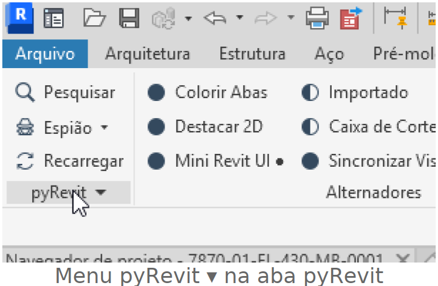
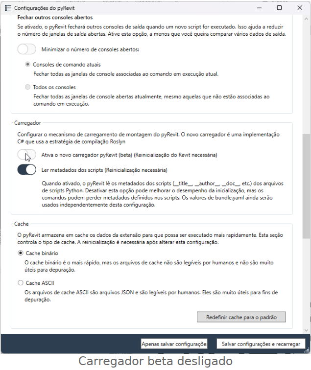
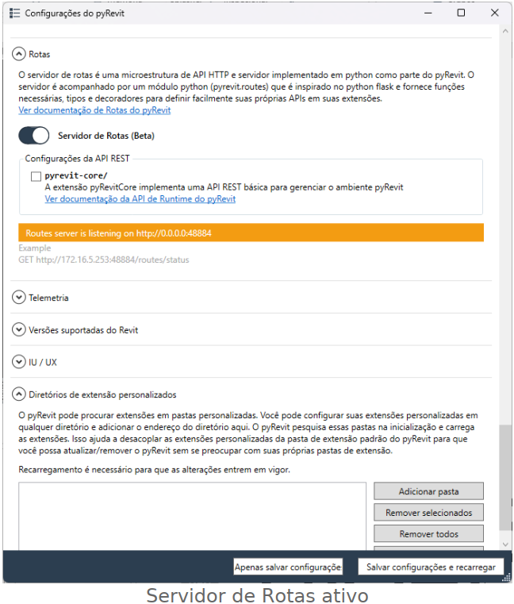

# MCP Revit 2026

Tutoriais para conectar agentes de IA ao Revit via pyRevit + [revit-mcp-server](https://github.com/Demolinator/revit-mcp-server) (48 ferramentas). Testado no Revit 2026 com pyRevit 6.5.5.

## Escolha o agente

| Agente | Tutorial |
|---|---|
| **Claude** (Claude Code + Claude Desktop) | [claude/](claude/README.md) — passo a passo + arquivo [`setup-revit-mcp.md`](claude/setup-revit-mcp.md) para o Claude Code executar |
| **Google Antigravity** | [antigravity/](antigravity/README.md) — cole o arquivo numa conversa nova do Antigravity |
| **ChatGPT / Codex** | [chatgpt/](chatgpt/README.md) — cadastro do MCP local no Codex e no app do ChatGPT para Windows |

## pyRevit (pré-requisito de todos)

### 1. Instalar

Com o Revit fechado, baixe e execute o instalador. Versão testada: **[⬇ pyRevit_6.5.5.26237_signed.exe](https://github.com/pyrevitlabs/pyRevit/releases/download/v6.5.5.26237%2B2044/pyRevit_6.5.5.26237_signed.exe)** (download direto).

Versões novas: [github.com/pyrevitlabs/pyRevit/releases](https://github.com/pyrevitlabs/pyRevit/releases)

### 2. Configurar

Abra o Revit e um projeto. Na aba **pyRevit**, clique no menu **pyRevit ▾** (abaixo de "Recarregar") e escolha **Configurações**.

**a) Desligue o novo carregador.** Em **Carregador**, desative **"Ativa o novo carregador pyRevit (beta)"**. Com ele ligado, a extensão do MCP não carrega.

**b) Ative o servidor de rotas.** Em **Rotas**, ligue **Servidor de Rotas (Beta)**. A opção `pyrevit-core/` não é necessária.

> **Importante:** clique em **Apenas salvar configuração** e feche o Revit. Nunca use "Salvar configurações e recarregar" nem o botão Recarregar com as Rotas ativas: é um bug conhecido do pyRevit que derruba o Revit na próxima requisição.

## Avisos

- Nunca use "Recarregar" nem "Salvar configurações e recarregar" do pyRevit com o Servidor de Rotas ligado: derruba o Revit.
- Nos primeiros usos, trabalhe numa cópia do modelo.
- Não use mais de um agente (Claude, Antigravity, ChatGPT/Codex) no Revit ao mesmo tempo.
