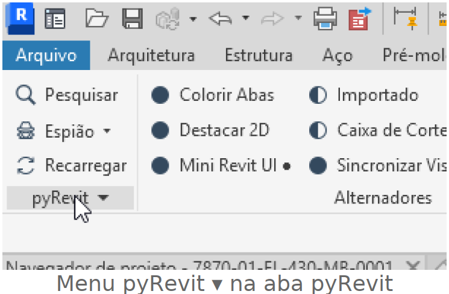
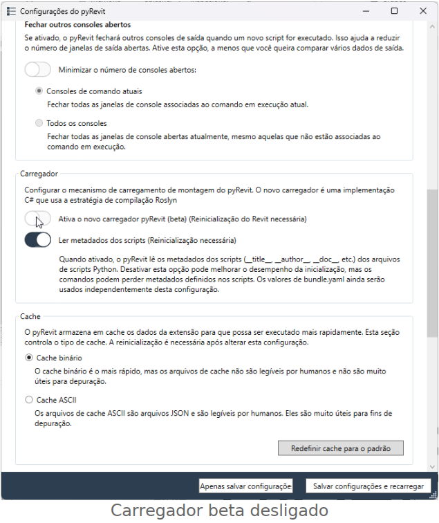
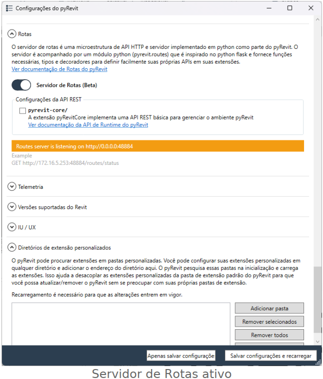

# Conectar o Revit ao Google Antigravity (instruções para o agente)
 
> **Para quem vai usar:** abra o Antigravity, clique em **New Conversation**, cole este texto inteiro (ou anexe este arquivo) e envie. O agente vai fazer a configuração e parar nos pontos em que precisa de você. Testado no Revit 2026 com pyRevit 6.5.5.
 
---
 
## Para o agente: objetivo e regras
 
Você vai configurar este computador Windows para que o Antigravity use as ferramentas do Revit através do servidor MCP `revit-mcp-server` (48 ferramentas), que funciona dentro do Revit via pyRevit.
 
Como funciona: o pyRevit cria um servidor HTTP local dentro do Revit (Rotas, porta 48884). A extensão `revit-mcp-server` publica nele as rotas do Revit. O Antigravity inicia o `main.py` dessa extensão como servidor MCP (stdio), e o `main.py` repassa cada ferramenta para essas rotas.
 
**Regras obrigatórias:**
 
1. **Trabalhe por etapas.** Ao chegar em uma linha **⏸ PARE**, mostre o que encontrou ou fez e **espere a resposta do usuário** antes de seguir. Não junte etapas.
2. **Nada de caminhos fixos.** Descubra os caminhos reais desta máquina (`$env:APPDATA`, `$env:USERPROFILE`, `where.exe uv`). Nunca use `rafael.martins`, `USUARIO` ou outro usuário de exemplo.
3. **Não use PowerShell como administrador** e não altere configurações de segurança do Windows.
4. **Antes de editar qualquer arquivo de configuração, faça backup** (`.bak`) e mostre ao usuário o caminho do backup.
5. **Não remova nem altere outros servidores MCP** que já existam no `mcp_config.json`.
6. **Grave JSON sempre com Python** (`json.dump`, UTF-8 **sem BOM**). Não use `Set-Content`, `Out-File` nem `>` do PowerShell 5.1 para JSON: eles podem gravar BOM ou outra codificação e o Antigravity deixa de ler o arquivo.
7. **Se a pasta da extensão já existir** (por exemplo, porque a pessoa já usa o Revit com o Claude), **não apague, não atualize e não rode `git pull` nela.** Reaproveite como está. Outro aplicativo pode depender dela.
8. **Nunca use "Salvar configurações e recarregar" nem o botão "Recarregar" do pyRevit** com as Rotas ativas. É um bug conhecido do pyRevit que derruba o Revit na próxima requisição. Depois de mudar configurações, feche e abra o Revit.
9. Se algum comando falhar, mostre o erro completo ao usuário e explique a causa provável antes de tentar outra coisa.
 
---
 
## Etapa 0: Diagnóstico (sem alterar nada)
 
Rode e mostre ao usuário uma tabela com o resultado de cada item:
 
```powershell
"Usuário: $env:USERNAME"
"APPDATA: $env:APPDATA"
"Revit instalado: " + ((Get-ChildItem "C:\Program Files\Autodesk" -Directory -Filter "Revit 20*" -ErrorAction SilentlyContinue).Name -join ", ")
"Revit aberto: " + [bool](Get-Process Revit -ErrorAction SilentlyContinue)
"pyRevit CLI: " + (Get-Command pyrevit -ErrorAction SilentlyContinue).Source
"Config pyRevit: " + (Test-Path "$env:APPDATA\pyRevit\pyRevit_config.ini")
"uv: " + ((where.exe uv 2>$null) -join ", ")
"git: " + (Get-Command git -ErrorAction SilentlyContinue).Source
"Pasta da extensão: " + (Test-Path "$env:APPDATA\pyRevit\Extensions\mcp-server-for-revit-python.extension\main.py")
"venv da extensão: " + (Test-Path "$env:APPDATA\pyRevit\Extensions\mcp-server-for-revit-python.extension\.venv\Scripts\python.exe")
"mcp_config.json do Antigravity: " + (Test-Path "$env:USERPROFILE\.gemini\config\mcp_config.json")
```
 
Com base nisso, diga ao usuário quais etapas abaixo já estão feitas e quais faltam. Pule as que já estiverem feitas.
 
**⏸ PARE.**
 
---
 
## Etapa 1: Instalar o pyRevit (só se não estiver instalado)
 
Peça ao **usuário** para:
 
1. Fechar o Revit.
2. Baixar o instalador do pyRevit. Versão testada (download direto): <https://github.com/pyrevitlabs/pyRevit/releases/download/v6.5.5.26237%2B2044/pyRevit_6.5.5.26237_signed.exe>. Versões novas: <https://github.com/pyrevitlabs/pyRevit/releases>.
3. Executar o instalador e avançar com as opções padrão.
 
Não baixe nem execute o instalador você mesmo.
 
**⏸ PARE** até o usuário confirmar a instalação.
 
---
 
## Etapa 2: Configurar o pyRevit
 
São necessárias duas opções:
 
| Opção | No arquivo `%APPDATA%\pyRevit\pyRevit_config.ini` | Na tela de configurações |
|---|---|---|
| Novo carregador **desligado** (com ele ligado, a extensão do MCP não carrega) | seção `[core]`: `new_loader = false` | Carregador → "Ativa o novo carregador pyRevit (beta)" desligado |
| Servidor de Rotas **ligado** | seção `[routes]`: `enabled = true` | Rotas → "Servidor de Rotas (Beta)" ligado |
 
Leia o `.ini` e informe o estado atual das duas opções. Se já estiverem corretas, pule para a Etapa 3.
 
Se precisar mudar, o caminho mais seguro é **o usuário fazer pela tela**:
 
1. Abra o Revit e um projeto.
2. Na aba **pyRevit**, clique no menu **pyRevit ▾** (abaixo de "Recarregar") → **Configurações**.
3. Em **Carregador**, **desligue** "Ativa o novo carregador pyRevit (beta)".
4. Em **Rotas**, **ligue** "Servidor de Rotas (Beta)". A opção `pyrevit-core/` não é necessária.
5. Clique em **Apenas salvar configuração** (nunca em "Salvar configurações e recarregar").
6. **Feche o Revit e abra de novo.**
 

 

 

 
Alternativa, só se o usuário autorizar e **com o Revit fechado** (o Revit sobrescreve o `.ini` ao fechar): faça backup do `.ini` e ajuste as duas linhas com Python, preservando o resto do arquivo.
 
**⏸ PARE** até o usuário confirmar que fez e reiniciou o Revit.
 
---
 
## Etapa 3: Instalar o uv (só se `where.exe uv` não encontrou nada)
 
O uv gerencia o Python e as bibliotecas do servidor num ambiente isolado.
 
```powershell
powershell -ExecutionPolicy ByPass -c "irm https://astral.sh/uv/install.ps1 | iex"
```
 
Depois confirme com `& "$env:USERPROFILE\.local\bin\uv.exe" --version`. Use sempre o **caminho completo** do `uv.exe` daqui em diante (normalmente `%USERPROFILE%\.local\bin\uv.exe`), porque o PATH do terminal atual pode não ter sido atualizado.
 
---
 
## Etapa 4: Baixar o servidor MCP (só se a pasta da extensão não existir)
 
Lembre a regra 7: se a pasta já existir, **não mexa nela** e pule para a Etapa 5.
 
Com git:
 
```powershell
$extRoot = "$env:APPDATA\pyRevit\Extensions"
New-Item -ItemType Directory -Force $extRoot | Out-Null
git clone https://github.com/Demolinator/revit-mcp-server.git "$extRoot\mcp-server-for-revit-python.extension"
```
 
Sem git: baixe <https://github.com/Demolinator/revit-mcp-server/archive/refs/heads/master.zip>, extraia e renomeie a pasta extraída para `mcp-server-for-revit-python.extension` dentro de `%APPDATA%\pyRevit\Extensions`. O `main.py` precisa ficar diretamente dentro dela, não numa subpasta.
 
Depois, em qualquer um dos dois casos:
 
```powershell
$ext = "$env:APPDATA\pyRevit\Extensions\mcp-server-for-revit-python.extension"
& "$env:USERPROFILE\.local\bin\uv.exe" sync --directory $ext
Test-Path "$ext\.venv\Scripts\python.exe"   # tem que dar True
```
 
O nome da pasta precisa terminar em `.extension`, senão o pyRevit não carrega. Peça ao usuário para **fechar e abrir o Revit** para o pyRevit carregar a extensão nova.
 
**⏸ PARE** até o usuário reabrir o Revit com um projeto.
 
---
 
## Etapa 5: Testar a extensão dentro do Revit
 
Com o Revit aberto **e um projeto aberto** (não basta a tela inicial):
 
```powershell
Invoke-RestMethod http://localhost:48884/revit_mcp/status/
```
 
Resposta esperada: `status = active`, `health = healthy`, `revit_available = True` e o nome do projeto em `document_title`.
 
| Erro | Causa e solução |
|---|---|
| Conexão recusada na porta 48884 | Servidor de Rotas desligado (Etapa 2) ou Revit sem projeto aberto. |
| `Route does not exits` / 404 | A extensão não carregou: carregador beta ligado (Etapa 2), pasta com nome errado (Etapa 4) ou Revit não foi reiniciado. |
| Revit fecha sozinho | Foi usado "Recarregar" com as Rotas ativas. Feche e abra o Revit. |
 
**⏸ PARE** e mostre o resultado.
 
---
 
## Etapa 6: Criar a ponte de compatibilidade
 
**Por que existe:** o Antigravity abre a conexão MCP com a mensagem `server/discover` (protocolo MCP 2026-07-28). O servidor do Revit usa uma biblioteca MCP antiga que descarta essa mensagem **sem responder**, e o Antigravity fica eternamente em `still connecting` (aparece em `%APPDATA%\Antigravity\logs\language_server.log`). Esta ponte responde "method not found" a essa mensagem. Com isso, o Antigravity volta para o `initialize` clássico, que o servidor entende. O resto é repassado sem alteração. A ponte **não modifica o servidor do Revit**, que continua funcionando para outros aplicativos.
 
Crie a pasta `%USERPROFILE%\.gemini\config\revit-mcp\` e, dentro dela, o arquivo `proxy.py` **exatamente** com este conteúdo:
 
```python
"""Ponte stdio entre o Antigravity e o servidor MCP do Revit.
 
Uso: python -I proxy.py <comando do servidor...>
O Antigravity abre a conexao com "server/discover" (protocolo MCP 2026-07-28).
O servidor do Revit usa uma biblioteca MCP antiga que descarta essa mensagem sem
responder, e o Antigravity fica em "still connecting" para sempre. Esta ponte
responde "method not found" a essa mensagem, o Antigravity volta para o
"initialize" classico, e todo o resto e repassado sem alteracao.
O log da ultima execucao fica em proxy.log, ao lado deste arquivo.
"""
import json
import os
import subprocess
import sys
import threading
import time
 
HERE = os.path.dirname(os.path.abspath(__file__))
LOG = open(os.path.join(HERE, "proxy.log"), "w", encoding="utf-8", buffering=1)
MAX_LOGGED = 300
log_lock = threading.Lock()
out_lock = threading.Lock()
 
 
def log(tag, data):
    text = repr(data)
    if len(text) > MAX_LOGGED:
        text = text[:MAX_LOGGED] + " ...[+%d]" % (len(text) - MAX_LOGGED)
    with log_lock:
        LOG.write("%s %s %s\n" % (time.strftime("%H:%M:%S"), tag, text))
 
 
def write_client(data):
    with out_lock:
        sys.stdout.buffer.write(data)
        sys.stdout.buffer.flush()
 
 
def client_to_server(proc):
    try:
        for line in sys.stdin.buffer:
            log("CLIENTE->SERVIDOR", line)
            try:
                msg = json.loads(line)
            except ValueError:
                msg = None
            if isinstance(msg, dict) and msg.get("method") == "server/discover" and "id" in msg:
                reply = json.dumps({"jsonrpc": "2.0", "id": msg["id"],
                                    "error": {"code": -32601, "message": "Method not found"}}) + "\n"
                log("PONTE->CLIENTE", reply)
                write_client(reply.encode("utf-8"))
                continue
            proc.stdin.write(line)
            proc.stdin.flush()
        log("CLIENTE->SERVIDOR", "<EOF>")
    except Exception as e:  # noqa: BLE001
        log("CLIENTE->SERVIDOR", "<ERRO %s>" % e)
    finally:
        try:
            proc.stdin.close()
        except Exception:  # noqa: BLE001
            pass
 
 
def server_to_client(proc):
    while True:
        chunk = proc.stdout.read1(65536)
        if not chunk:
            log("SERVIDOR->CLIENTE", "<EOF>")
            return
        log("SERVIDOR->CLIENTE", chunk)
        write_client(chunk)
 
 
def server_stderr(proc):
    while True:
        chunk = proc.stderr.read1(65536)
        if not chunk:
            return
        log("SERVIDOR-STDERR", chunk)
 
 
def main():
    cmd = sys.argv[1:]
    if not cmd:
        sys.exit("uso: python -I proxy.py <comando do servidor...>")
    log("INICIO", {"pid": os.getpid(), "cmd": cmd})
    proc = subprocess.Popen(cmd, stdin=subprocess.PIPE, stdout=subprocess.PIPE, stderr=subprocess.PIPE)
    for target in (client_to_server, server_to_client, server_stderr):
        threading.Thread(target=target, args=(proc,), daemon=True).start()
    log("FIM", proc.wait())
 
 
if __name__ == "__main__":
    main()
```
 
---
 
## Etapa 7: Registrar o servidor no Antigravity
 
1. **Confirme o local do arquivo.** A documentação embutida do Antigravity fica em `%USERPROFILE%\.gemini\antigravity\builtin\skills\agy-customizations\docs\mcp_servers.md`. Leia a seção "Location" e use o caminho de "Global Configuration" que estiver lá (hoje é `~/.gemini/config/mcp_config.json`). Mostre ao usuário o caminho confirmado.
2. **Backup:** se o arquivo existir, copie para `mcp_config.json.bak`. Se existir e estiver vazio, trate como `{}`.
3. **Adicione a entrada `revit`** com Python, mesclando com o que já existe. Use o Python do venv da extensão (Etapa 4) para rodar este script e ajuste `CFG` se a etapa 1 desta seção indicar outro caminho:
 
```python
import json, os, shutil
ext = os.path.expandvars(r"%APPDATA%\pyRevit\Extensions\mcp-server-for-revit-python.extension")
uv = shutil.which("uv") or os.path.expanduser(r"~\.local\bin\uv.exe")
proxy = os.path.expanduser(r"~\.gemini\config\revit-mcp\proxy.py")
CFG = os.path.expanduser(r"~\.gemini\config\mcp_config.json")
for p in (ext + r"\main.py", ext + r"\.venv\Scripts\python.exe", uv, proxy):
    assert os.path.exists(p), "não encontrado: " + p
cfg = {}
if os.path.exists(CFG) and os.path.getsize(CFG) > 0:
    cfg = json.load(open(CFG, encoding="utf-8-sig"))
cfg.setdefault("mcpServers", {})["revit"] = {
    "command": ext + r"\.venv\Scripts\python.exe",
    "args": ["-I", proxy, os.path.abspath(uv), "--directory", ext, "run", "main.py"],
}
with open(CFG, "w", encoding="utf-8") as f:
    json.dump(cfg, f, indent=2, ensure_ascii=False)
print(open(CFG, encoding="utf-8").read())
```
 
4. Mostre o arquivo final ao usuário e confirme que os outros servidores, se havia algum, continuam lá.
 
---
 
## Etapa 8: Testar a conexão fora do Antigravity
 
Crie `%USERPROFILE%\.gemini\config\revit-mcp\teste_conexao.py` com o conteúdo abaixo. Ele simula exatamente o que o Antigravity faz:
 
```python
"""Simula o Antigravity: roda a entrada "revit" do mcp_config.json e faz a conexao."""
import json
import os
import subprocess
import sys
import threading
import time
 
cfg_path = sys.argv[1] if len(sys.argv) > 1 else os.path.expanduser(r"~\.gemini\config\mcp_config.json")
srv = json.load(open(cfg_path, encoding="utf-8"))["mcpServers"]["revit"]
p = subprocess.Popen([srv["command"]] + srv.get("args", []), stdin=subprocess.PIPE, stdout=subprocess.PIPE,
                     stderr=subprocess.DEVNULL)
replies = {}
threading.Thread(target=lambda: [replies.setdefault(json.loads(l).get("id"), json.loads(l)) for l in p.stdout],
                 daemon=True).start()
 
 
def ask(msg_id, method, params=None, wait=20):
    msg = {"jsonrpc": "2.0", "method": method, "params": params or {}}
    if msg_id is not None:
        msg["id"] = msg_id
    p.stdin.write((json.dumps(msg) + "\n").encode("utf-8"))
    p.stdin.flush()
    if msg_id is None:
        return None
    end = time.time() + wait
    while msg_id not in replies and time.time() < end:
        time.sleep(0.1)
    return replies.get(msg_id)
 
 
ok = True
r = ask(1, "server/discover", {"_meta": {"io.modelcontextprotocol/protocolVersion": "2026-07-28"}})
print("1. server/discover:", "recusado (esperado)" if r and "error" in r else "SEM RESPOSTA" if not r else r)
ok &= bool(r)
r = ask(2, "initialize", {"protocolVersion": "2025-11-25", "capabilities": {},
                          "clientInfo": {"name": "teste", "version": "0"}})
print("2. initialize:", r["result"]["serverInfo"] if r and "result" in r else "FALHOU: %s" % r)
ok &= bool(r and "result" in r)
ask(None, "notifications/initialized")
r = ask(3, "tools/list")
n = len(r["result"]["tools"]) if r and "result" in r else 0
print("3. ferramentas:", n)
ok &= n > 0
r = ask(4, "tools/call", {"name": "get_revit_status", "arguments": {}}, wait=40)
text = r["result"]["content"][0]["text"] if r and "result" in r else "FALHOU: %s" % r
print("4. get_revit_status:", text.replace("\n", " | "))
p.kill()
print("RESULTADO:", "OK" if ok else "FALHOU")
```
 
Rode com o Python do venv da extensão:
 
```powershell
$ext = "$env:APPDATA\pyRevit\Extensions\mcp-server-for-revit-python.extension"
& "$ext\.venv\Scripts\python.exe" -I "$env:USERPROFILE\.gemini\config\revit-mcp\teste_conexao.py"
```
 
Resultado esperado: `server/discover` recusado, `initialize` com `Revit MCP Server`, cerca de 48 ferramentas, `get_revit_status` com `active (healthy)` e o nome do projeto, e `RESULTADO: OK`. Se falhar, leia `%USERPROFILE%\.gemini\config\revit-mcp\proxy.log` e mostre ao usuário.
 
**⏸ PARE** e mostre o resultado.
 
---
 
## Etapa 9: Ativar no Antigravity (o usuário faz)
 
Diga ao usuário:
 
1. **Feche o Antigravity por completo** (File → Exit, ou pela bandeja do sistema) e abra de novo. Ele só lê o `mcp_config.json` ao iniciar.
2. Clique em **New Conversation** e peça: **"use get_revit_status"**. Ele deve responder com o nome do projeto aberto no Revit.
3. Depois, para um teste maior: **"liste os níveis do modelo"**.
 
Se as ferramentas do Revit não aparecerem na conversa nova:
 
| Onde olhar | O que significa |
|---|---|
| `%APPDATA%\Antigravity\logs\language_server.log` com `still connecting ... revit` | A ponte não está sendo usada. Confira se o `mcp_config.json` aponta para o `proxy.py` (Etapa 7). |
| `proxy.log` sem nenhuma linha recente | O Antigravity não iniciou o servidor: arquivo de configuração em outro lugar ou JSON inválido. Valide com Python. |
| `proxy.log` com `SERVIDOR-STDERR` e erro Python | Problema no servidor: rode `uv sync` de novo (Etapa 4) e repita a Etapa 8. |
| `get_revit_status` responde, mas diz que o Revit está inacessível | Revit fechado, sem projeto aberto ou Rotas desligadas (Etapas 2 e 5). |
 
---
 
## Cuidados para o usuário
 
- **O agente pode apagar e modificar elementos do modelo.** Nos primeiros usos, trabalhe numa cópia do projeto.
- **Não use o Claude e o Antigravity no Revit ao mesmo tempo.** Os dois podem ficar conectados, mas o pyRevit atende todas as requisições com um único manipulador. Comandos simultâneos dos dois podem se misturar.
- **Não apague a pasta `%USERPROFILE%\.gemini\config\revit-mcp`.** Sem a ponte, o Antigravity volta a ficar em "still connecting".
- **Firewall:** o servidor de Rotas escuta em toda a rede (`0.0.0.0:48884`). Se o Windows perguntar, **não libere** o acesso. A conexão local continua funcionando.
- **Permissões do Antigravity:** em Settings → Conversations → MCP Tools dá para deixar ferramentas em "Allow" para não pedir confirmação. Evite liberar `delete_elements` e `execute_revit_code` sem confirmação.
- **Famílias:** a API do Revit não permite editar rótulos de famílias. Ao trocar parâmetros de um carimbo, peça ao agente para usar `FamilyManager.ReplaceParameter` em vez de apagar e recriar, assim os rótulos continuam ligados.