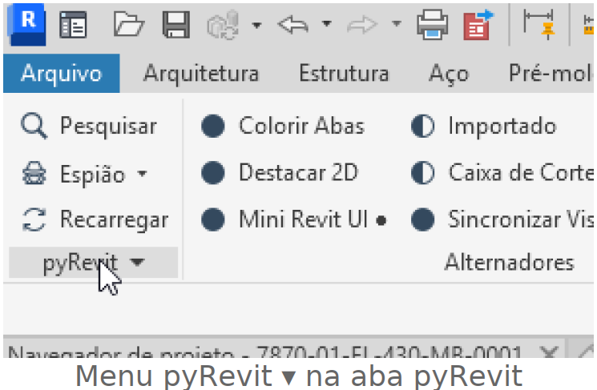
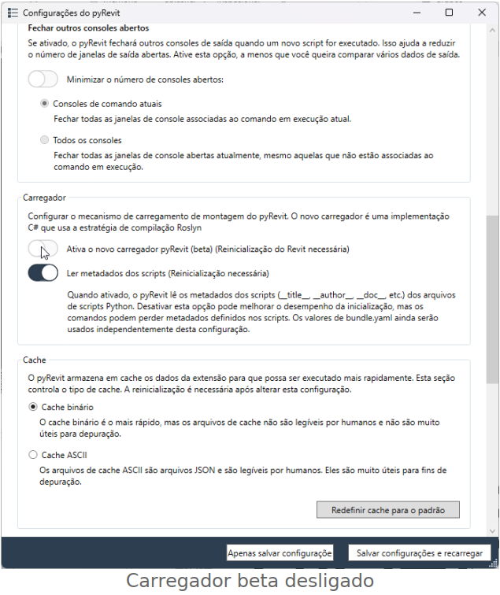
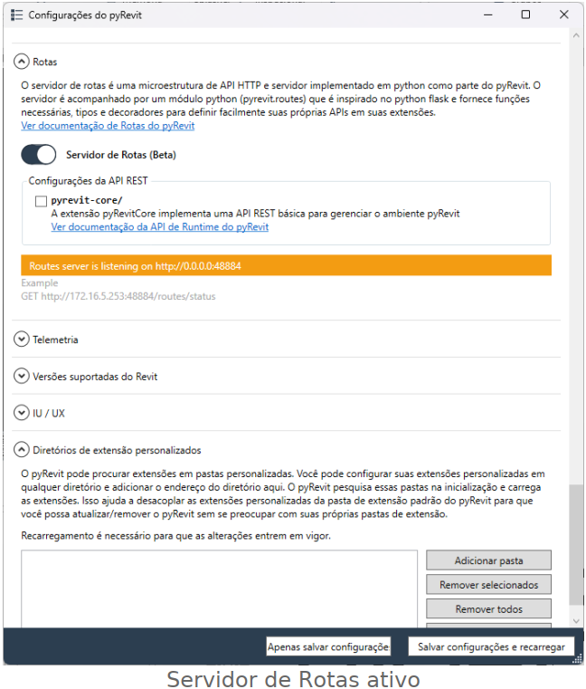
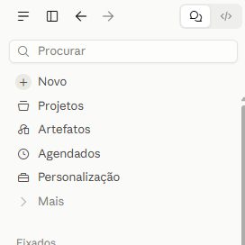

# Como conectar o Claude ao Revit

Tutorial com pyRevit + servidor MCP. Testado no Revit 2026 com pyRevit 6.5.5.

**Visão geral.** Você instala e configura o pyRevit à mão (passos 1 e 2). O resto (uv, extensão revit-mcp-server com 48 ferramentas, registro no Claude Code e no Claude Desktop e teste) fica a cargo do Claude Code, que segue o arquivo [`setup-revit-mcp.md`](setup-revit-mcp.md) (passo 3).

**Pré-requisitos:** Revit 2024 a 2027, Windows, Claude Desktop com conta Pro ou superior e o arquivo [`setup-revit-mcp.md`](setup-revit-mcp.md).

> Versão em PDF: [Tutorial_Claude_Revit.pdf](Tutorial_Claude_Revit.pdf)

## 1. Instalar o pyRevit

Com o Revit fechado, baixe e execute o instalador:

**[⬇ pyRevit_6.5.5.26237_signed.exe](https://github.com/pyrevitlabs/pyRevit/releases/download/v6.5.5.26237%2B2044/pyRevit_6.5.5.26237_signed.exe)** (download direto, versão testada)

Versões novas: [github.com/pyrevitlabs/pyRevit/releases](https://github.com/pyrevitlabs/pyRevit/releases)

## 2. Configurar o pyRevit

Abra o Revit e um projeto. Na aba **pyRevit**, clique no menu **pyRevit ▾** (abaixo de "Recarregar") e escolha **Configurações**.



**a) Desligue o novo carregador.** Em Carregador, desative **"Ativa o novo carregador pyRevit (beta)"**. Com ele ligado, a extensão do MCP não carrega.



**b) Ative o servidor de rotas.** Em **Rotas**, ligue **Servidor de Rotas (Beta)**. A opção "pyrevit-core/" não é necessária.



> **Importante:** clique em **Apenas salvar configuração** e feche o Revit. Nunca use "Salvar configurações e recarregar" nem o botão Recarregar com as Rotas ativas: é um bug conhecido do pyRevit que derruba o Revit na próxima requisição.

## 3. Deixar o Claude Code fazer o resto

**a) Abra o Code no Claude Desktop.** No canto superior esquerdo, clique no ícone **</>** (ao lado do ícone de chat).



**b) Anexe o [`setup-revit-mcp.md`](setup-revit-mcp.md) e envie a mensagem.** Arraste o arquivo para a caixa de mensagem e escreva:

```
Execute todas as etapas deste arquivo até deixar tudo funcionando.
```

Ele instala o uv, baixa a extensão, prepara o Python, registra o MCP no Claude Code e no Claude Desktop, faz backup das configurações e testa. Quando pedir permissão para rodar comandos, autorize. Se ele pedir para abrir o Revit com um projeto, abra e avise.

## 4. Primeiro teste

Reinicie o Claude Desktop pela bandeja do sistema (botão direito > Sair) e abra o Revit com um projeto. No chat, peça: "verifique o status do Revit" e depois "liste os níveis do modelo".

## Problemas comuns

| Sintoma | Causa e solução |
|---|---|
| Revit fecha sozinho ao usar o Claude | Foi usado Recarregar com as Rotas ativas. Feche e abra o Revit. |
| "Route does not exist: revit_mcp/status/" | Extensão não carregou. Confira o carregador beta (passo 2a) e reinicie o Revit. |
| "connection refused" na porta 48884 | Servidor de Rotas desligado ou Revit sem projeto aberto. |
| revit não aparece no chat do Claude Desktop | Feche o Claude Desktop pela bandeja e abra de novo. |
| Qualquer outro erro | Abra o Code, descreva o erro e peça para ele corrigir. |

## Cuidados

- O Claude pode apagar e modificar elementos. Nos primeiros usos, trabalhe numa cópia do modelo.
- O servidor de Rotas escuta em toda a rede (0.0.0.0:48884). Se o Firewall do Windows perguntar, não libere o acesso; a conexão local continua funcionando.
- A API do Revit não permite editar rótulos de famílias. Ao trocar parâmetros de um carimbo, peça ao Claude para usar `FamilyManager.ReplaceParameter` em vez de apagar e recriar.
